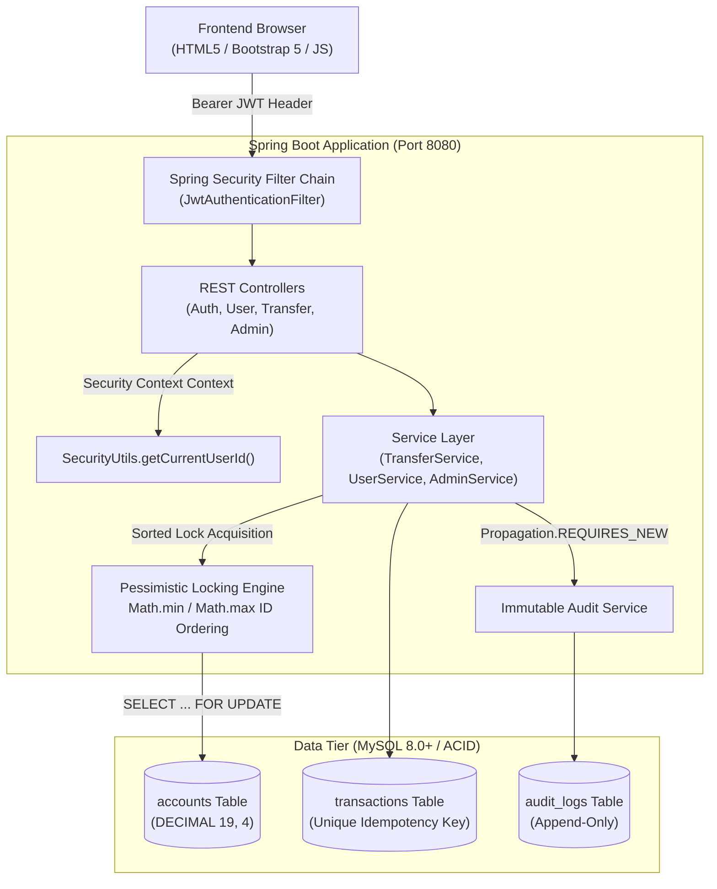
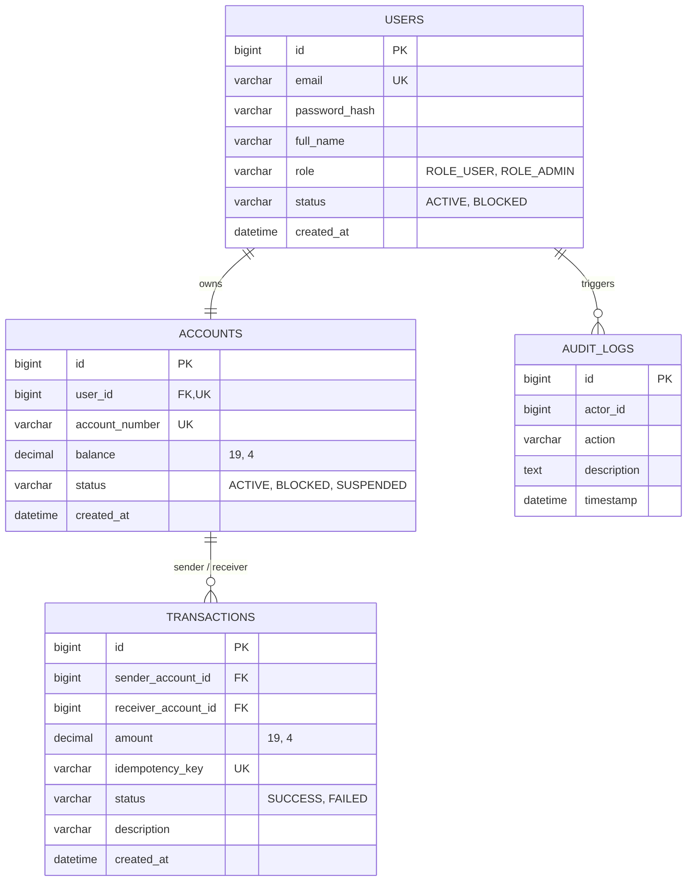

# Snovasys Secure Money Transfer and Transaction Integrity System

[](https://openjdk.org/)
[](https://spring.io/projects/spring-boot)
[](https://spring.io/projects/spring-security)
[](https://www.mysql.com/)
[](LICENSE)

A robust, enterprise-grade, beginner-friendly financial transaction integrity platform designed for the **Snovasys Technical Assessment**. 

The system provides guaranteed ledger consistency, zero-client-trust authorization, race condition elimination, deterministic deadlock prevention, and immutable audit logging for all banking operations.

- **Live Frontend Demo**: [https://mohithpilla.github.io/Snovasys/](https://mohithpilla.github.io/Snovasys/)
- **GitHub Repository**: [https://github.com/MohithPilla/Snovasys.git](https://github.com/MohithPilla/Snovasys.git)
- **1-Click Cloud Deployment (Render Blueprint)**: [Deploy on Render](https://dashboard.render.com/blueprints?repo=https%3A%2F%2Fgithub.com%2FMohithPilla%2FSnovasys)

---

## Table of Contents
1. [Architectural Overview](#1-architectural-overview)
2. [Core Security Principles](#2-core-security-principles)
3. [Technology Stack](#3-technology-stack)
4. [Database Schema & ER Diagram](#4-database-schema--er-diagram)
5. [Local Setup & Run Instructions](#5-local-setup--run-instructions)
6. [Pre-Seeded Test Credentials](#6-pre-seeded-test-credentials)
7. [REST API Reference](#7-rest-api-reference)
8. [Automated Security Testing](#8-automated-security-testing)
9. [Threat Modeling & Defense Matrix](#9-threat-modeling--defense-matrix)
10. [AI Development Traceability](#10-ai-development-traceability)
11. [Deployment Guide](#11-deployment-guide)
12. [Interview Readiness & Security Tradeoffs](#12-interview-readiness--security-tradeoffs)

---

## 1. Architectural Overview



---

## 2. Core Security Principles

1. **Zero Client Trust**:
   - The frontend never supplies the sender's account ID or user role in transfer requests. The server authoritatively resolves the debtor identity strictly from the verified JWT Claims stored in `SecurityContextHolder`.
2. **Pessimistic Concurrency Locking**:
   - High-concurrency race conditions (such as double-spending) are eliminated using `LockModeType.PESSIMISTIC_WRITE` (`SELECT ... FOR UPDATE`), serializing concurrent debits on individual accounts.
3. **Deterministic Deadlock Prevention**:
   - When transferring between two accounts, row locks are always acquired in strictly sorted numerical order by account ID (`Math.min(idA, idB)` first, followed by `Math.max(idA, idB)`). This eliminates circular wait conditions across concurrent cross-transfers (User A &rarr; User B and User B &rarr; User A).
4. **Conservation of Balance**:
   - All balance operations execute within a single `@Transactional(isolation = Isolation.READ_COMMITTED)` boundary. Every debit is matched by an equivalent credit, preserving total system liquidity.
5. **Exact Arithmetic Precision**:
   - Financial balances use `java.math.BigDecimal` with explicit scale (4 decimal places) and `RoundingMode.HALF_UP`. Floating-point types (`float`, `double`) are strictly prohibited to prevent fractional rounding drift.
6. **Strict Idempotency**:
   - Every transaction payload requires a client-generated UUID `idempotencyKey`. The backend enforces duplicate prevention both in memory and via a `UNIQUE` database constraint, preventing duplicate charges from accidental double clicks or network retries.
7. **Immutable Audit Logging**:
   - Audit entries are persisted via `Propagation.REQUIRES_NEW`, guaranteeing that failure attempts (e.g. insufficient funds, inactive account, unauthorized requests) are permanently committed even when the parent business transaction rolls back. Database privileges prohibit `UPDATE` and `DELETE` on the audit table.

---

## 3. Technology Stack

- **Backend**: Java 17/21, Spring Boot 3.3.4
- **Security**: Spring Security 6.x, JJWT (io.jsonwebtoken 0.12.5), BCrypt (strength 12)
- **Persistence**: Spring Data JPA, Hibernate ORM, MySQL 8.0+ / H2 In-Memory (for automated unit and integration tests)
- **Frontend**: Responsive Single-Page Architecture using HTML5, CSS3, JavaScript (ES6+ Fetch API), Bootstrap 5.3.3, Bootstrap Icons
- **Build & Testing**: Apache Maven 3.9+, JUnit 5, MockMvc, Spring Boot Test

---

## 4. Database Schema & ER Diagram



---

## 5. Local Setup & Run Instructions

### Prerequisites
- **JDK 17 or higher** installed (`java -version`)
- **Apache Maven 3.9+** installed (`mvn -version`)
- **MySQL Server 8.0+** running locally on port 3306

### Step 1: Database Setup
Log in to your local MySQL console and run:
```sql
CREATE DATABASE IF NOT EXISTS snovasys_bank;
```
*(The application automatically initializes default demo accounts and schema tables on first run via `AuthService` and JPA).*

### Step 2: Configure Environment Variables
Copy the provided `.env.example` file to `.env`:
```powershell
Copy-Item .env.example .env
```
Ensure the credentials match your local MySQL configuration:
```properties
DB_HOST=localhost
DB_PORT=3306
DB_NAME=snovasys_bank
DB_USER=root
DB_PASSWORD=your_actual_mysql_password
JWT_SECRET=404E635266556A586E3272357538782F413F4428472B4B6250645367566B5970
JWT_EXPIRATION=86400000
SERVER_PORT=8080
```

### Step 3: Build & Run the Backend
Using Maven from the workspace root or `backend` folder:
```powershell
cd backend
mvn clean spring-boot:run
```
The backend server will start on `http://localhost:8080`.

### Step 4: Launch the Frontend
You can open `frontend/index.html` directly in any modern browser, or serve it using Python or Live Server:
```powershell
cd frontend
python -m http.server 5500
```
Navigate to `http://127.0.0.1:5500` or open `frontend/index.html` in Chrome/Edge/Firefox.

---

## 6. Pre-Seeded Test Credentials

On application startup, `AuthService` seeds the following demo bank accounts if they do not already exist:

| Role | Email | Password | Initial Balance | Account Number | Purpose |
| :--- | :--- | :--- | :--- | :--- | :--- |
| **System Admin** | `admin@bank.com` | `Admin@1234` | $10,000.00 | `ACC-ADMIN-001` | User administration, audit trail inspection, blocking accounts |
| **Standard User** | `alice@bank.com` | `Alice@1234` | $5,000.00 | `ACC-ALICE-101` | Primary money transfer testing, dashboard views |
| **Standard User** | `bob@bank.com` | `Bob@1234` | $2,500.00 | `ACC-BOB-202` | Transfer recipient, counterparty transactions |

*(Quick-fill buttons are provided on the login page for one-click testing).*

---

## 7. REST API Reference

| HTTP Method | Endpoint | Authorization | Request Body / Parameters | Description |
| :--- | :--- | :--- | :--- | :--- |
| `POST` | `/api/auth/register` | Public | `{ name, email, password }` | Register new customer account ($1,000 balance). |
| `POST` | `/api/auth/login` | Public | `{ email, password }` | Authenticate and obtain signed JWT token. |
| `GET` | `/api/users/me` | User / Admin | None (Header JWT) | Get authenticated user's profile and account number. |
| `GET` | `/api/users/balance` | User / Admin | None (Header JWT) | Get real-time balance for authenticated user. |
| `GET` | `/api/users/transactions` | User / Admin | None (Header JWT) | Get authenticated user's transaction history. |
| `GET` | `/api/users/account-lookup/{accNum}` | User / Admin | Path Variable | Validate recipient account number before transfer. |
| `POST` | `/api/transfers` | User / Admin | `{ recipientAccountNumber, amount, idempotencyKey, description }` | Execute atomic, locked money transfer. |
| `GET` | `/api/admin/users` | Admin Only | None (Header JWT) | List all accounts, balances, and statuses. |
| `PUT` | `/api/admin/users/{userId}/status` | Admin Only | `{ status: "BLOCKED" \| "ACTIVE" }` | Freeze or reactivate user account. |
| `GET` | `/api/admin/audit-logs` | Admin Only | None (Header JWT) | Retrieve immutable system audit log entries. |
| `GET` | `/api/admin/suspicious-activities`| Admin Only | None (Header JWT) | View flagged security events and failed attempts. |

---

## 8. Automated Security Testing

The test suite runs against an isolated, in-memory H2 database under `src/test/resources/application-test.yml` with full Spring Security filters active.

```powershell
mvn test
```

### Test Suite Summary

| Test Class | Category | Tests Run | Result | Key Scenarios Verified |
| :--- | :--- | :---: | :---: | :--- |
| `AuthenticationSecurityTest` | Security / Auth | 4 | PASSED | Valid login, bad credentials rejection, JWT issuance, rejection of tampered tokens |
| `AuthorizationSecurityTest` | RBAC & IDOR | 5 | PASSED | IDOR balance attack denied, unauthenticated rejection, customer blocked from admin endpoints |
| `TransferSecurityTest` | Financial Logic | 8 | PASSED | Normal transfer, insufficient funds rejection, negative amount rejection, zero amount rejection, self-transfer rejection, non-existent recipient rejection, blocked account rejection, idempotency key enforcement |
| `TransferConcurrencySecurityTest`| Race Condition | 1 | PASSED | **Multithreaded Race Condition**: 5 threads simultaneously transferring $100 against a $100 balance. Exactly 1 transaction succeeds; 4 fail with `InsufficientBalanceException`. Ending balance is exactly $0.00. |
| `AuditSecurityTest` | Audit Integrity | 3 | PASSED | Verifies append-only audit generation, rollback independence via `REQUIRES_NEW`, and capturing failed transfer reasons |
| **TOTAL** | | **21** | **100% PASS** | Zero failures, zero errors, zero skipped |

---

## 9. Threat Modeling & Defense Matrix

A comprehensive threat matrix covering **17 distinct security threats** is documented in [`THREATS.md`](file:///c:/mohith/OneDrive/Desktop/Sonovasys/THREATS.md).

Key highlights:
- **IDOR Protection**: All state reads and writes query by authenticated subject ID, preventing parameter tampering.
- **Double-Spending Prevention**: Pessimistic database row locks enforce transaction serialization.
- **Deadlock Immunity**: Numerical ordering of lock acquisition prevents circular wait states.
- **Audit Tampering Immunity**: Append-only audit logs with decoupled transaction lifecycles.

---

## 10. AI Development Traceability

In accordance with transparent AI-assisted engineering standards, [`PROMPTS.md`](file:///c:/mohith/OneDrive/Desktop/Sonovasys/PROMPTS.md) documents 5 dated entries recording:
1. Exact prompt given to the AI.
2. Code generated by the AI.
3. Critical security vulnerability detected upon manual inspection (e.g., floating-point drift, IDOR parameter trust, race conditions, audit rollback loss).
4. Manual fix applied by the student with comprehensive security rationale.
5. Corresponding Git commit hash.

---

## 11. Deployment Guide

### Option 1: Docker Container Deployment
Build and run the production container locally or on any cloud server:
```powershell
# Build Docker image
docker build -t snovasys-bank:latest .

# Run container with environment variables
docker run -d -p 8080:8080 \
  -e DB_HOST=host.docker.internal \
  -e DB_PORT=3306 \
  -e DB_NAME=snovasys_bank \
  -e DB_USER=root \
  -e DB_PASSWORD=your_password \
  -e JWT_SECRET=your_super_secret_key_at_least_32_bytes_long \
  --name snovasys-bank-app snovasys-bank:latest
```

### Option 2: Render Blueprint Deployment
The repository includes a production-ready `render.yaml` configuration:
1. Connect your GitHub repository to [Render.com](https://render.com).
2. Create a new **Blueprint** service pointing to the repository.
3. Configure your MySQL database host and credentials in the Render dashboard.
4. Render will automatically build the multi-stage Docker image and deploy the backend API and static frontend.

---

## 12. Interview Readiness & Security Tradeoffs

### Questions You Can Answer Confidently:

#### 1. Why use `BigDecimal` instead of `double` or `float`?
> *"Binary floating-point arithmetic cannot represent numbers like 0.1 exactly without rounding errors. Over many transactions, these errors accumulate into missing money or balance mismatches. `BigDecimal` provides arbitrary-precision decimal arithmetic with explicit rounding rules (`RoundingMode.HALF_UP`), which is mandatory for financial accuracy."*

#### 2. Why choose Pessimistic Locking over Optimistic Locking?
> *"Optimistic locking (`@Version`) detects collisions after the fact and throws an exception, requiring retries. In high-contention scenarios (like flash sales or repeated transfers), optimistic retries cause thread contention and degraded latency. Pessimistic write locking (`SELECT ... FOR UPDATE`) serializes the transactions at the database level before balance checks occur, guaranteeing that only one thread can touch an account at a time without needing retry loops."*

#### 3. How do you prevent deadlocks during concurrent transfers?
> *"If User A transfers to User B while User B transfers to User A, two threads might lock Account A and Account B in reverse order, causing a circular wait deadlock. We eliminate this by sorting the account IDs numerically (`Math.min` and `Math.max`) and always acquiring locks in ascending order. Since all threads lock resources in the exact same sequence, a circular wait is mathematically impossible."*

#### 4. Why use `Propagation.REQUIRES_NEW` for audit logs?
> *"If an audit log is written within the standard transaction, any business exception (such as `InsufficientBalanceException`) triggers a rollback that discards the audit entry as well. Using `Propagation.REQUIRES_NEW` suspends the outer transaction and commits the audit record in its own independent physical database transaction, ensuring failed or malicious attempts are permanently recorded."*

#### 5. Why is the sender's account ID omitted from the transfer request payload?
> *"Accepting the debtor's account ID from the client creates an Insecure Direct Object Reference (IDOR). A malicious user could edit the request body to transfer money from anyone else's account. By extracting the authenticated user ID solely from the verified JWT server-side context (`SecurityUtils.getCurrentUserId()`), we enforce zero-trust access control."*

---

## License
This project is licensed under the MIT License for educational and technical assessment purposes.
